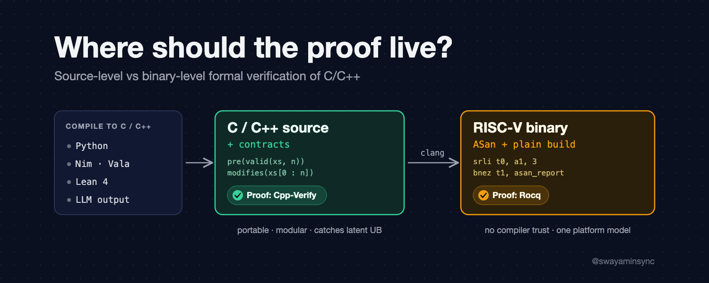

{fig-alt="Cover image: Where should the proof live? Source-level vs binary-level formal verification of C/C++" fig-align="center" width=100% .preview-image}

Anthropic, working with Theorem, just showed that real C and C++ code can come with a proof instead of just a test report. Using Claude, they proved that 239 OSS-Fuzz entry points across 123 open-source libraries can never crash on any input under 64 MB (on a formally modelled RISC-V Linux machine).

Not "we fuzzed it for a really long time". Proved. Checked by a proof assistant. Around 180 million lines of Rocq.

Anthropic's post: [LLMs are making formal software verification feasible at a much larger scale](https://www.anthropic.com/research/formal-verification)

I spend a lot of my time building a formal verifier for C++, so I read the post twice. Here's how it actually works, what I love about it, and the one place I'd bet differently.

## How their pipeline works

The main thing to understand is that they verify the compiled binary, not the C/C++ source. Here is the pipeline step by step.

1. They start from the existing OSS-Fuzz harnesses. A harness is a function that takes a byte buffer and calls into the library, and during fuzzing any crash (ASan error, failed assert, segfault) counts as a bug. So the harness already works as a spec. They just turn "the fuzzer couldn't find a crash" into "no input can cause a crash".

2. Each harness is built twice, once with ASan and once without. Each build links the harness, the library, musl libc and the C startup code (plus the ASan runtime for the first one) into a single static, single-threaded RISC-V executable. With ASan, a memory error has a concrete meaning in the binary: execution reaches the ASan report routine and aborts. Roughly, a store like `buf[i] = x` turns into something like this:

   ```
   # buf[i] = x with ASan (simplified)
   srli  t0, a1, 3          # shadow address = (addr >> 3) + offset
   add   t0, t0, s1
   lbu   t1, 0(t0)          # load the shadow byte
   bnez  t1, asan_report    # poisoned -> report and abort
   sb    a2, 0(a1)          # the actual store
   ```

3. Theorem has formal models of the RISC-V ISA and of a Linux process, written in Rocq. The RISC-V model defines the machine state (registers, program counter, memory) and how each instruction changes it. The Linux model defines what a system call (`ecall`) is allowed to return, and it is nondeterministic on purpose: for example, a `read` can return fewer bytes than requested, and memory addresses can differ between runs. The proof has to hold for every behaviour the model allows. Memory is also fixed in size, so running out of stack counts as a crash too.

4. Plugging both binaries into these models gives the theorem to prove. It is generated mechanically, and the template is the same for every library. Here a crash means a fault, an abort, or any behaviour the model doesn't cover (like a syscall missing from the Linux model). For every input under 64 MB and every memory layout, the theorem has three parts:

   1. The ASan build never crashes.
   2. The ASan build and the plain build behave the same: same stdin reads, same stdout/stderr writes, same exit code and same final file system state.
   3. The plain build never crashes either.

   Part 3 is needed because a crash and an infinite loop both just end the trace, so equivalence alone would not notice one build crashing where the other loops. As I read the appendix, it also means the theorem rules out crashes, not infinite loops.

5. Claude writes the proof and the Rocq kernel checks it. A typical proof is around 600K lines of Rocq. Nobody needs to review those lines because the checker does that. You only have to trust the RISC-V model, the Linux model, the theorem statement and the Rocq kernel.

6. When the proof gets stuck, it usually means there is a real bug. Claude patches the C source, the binary is rebuilt, a new theorem is generated, and the proof continues from there.

## What I liked

A few things I found really nice about this approach:

✅ The spec comes for free. Nobody had to write per-function annotations for 123 libraries, because the fuzz harnesses already existed.

✅ The trusted part stays small and fixed: the RISC-V model, the Linux model, the theorem statements and the Rocq kernel. Verifying more projects doesn't add anything to it.

✅ It finds bugs that fuzzers are very unlikely to hit. One was a counter underflow in a decompressor that only triggers on ~20 MB inputs with a specific layout. Another was an out-of-bounds read that needed a 64 MB input and more than 2 GB of memory. Fuzzers usually cap inputs around 1 MB.

Also, many harnesses assert real properties, like decompressing a compressed input giving back the original, so those get proven too. For cpp-httplib, Claude even had to prove on machine code that libc++'s red-black tree keeps its depth logarithmic, just to rule out a stack overflow in a destructor.

Really impressive work overall.

## Where I'd bet differently

My disagreement is not with the result but with the layer they verify at. The appendix explains their choice: translating the code into Rocq risks translation mistakes, and interpreting the source risks disagreeing with what the compiler actually produced. That is fair, and it is the compiler-trust trade-off I come back to below.

First, the proof covers static, single-threaded RISC-V binaries linked against musl. Most of us ship x86 or ARM binaries dynamically linked against glibc, and covering those needs accurate formal models for every ISA, OS and libc combination, kept up to date. The post lists this as a limitation too.

Second, undefined behaviour in the source can pass a binary proof. The proof says that the code this compiler produced today is fine. It doesn't say the source is free of UB. A classic example:

```cpp
// concept
int add_padding(int len) {
    if (len + 100 < len)   // "overflow check" on a signed int
        return -1;         // UB: the compiler may delete this branch
    return len + 100;
}
```

Signed overflow is UB, so the compiler is allowed to assume `len + 100 < len` is always false and remove the check. The binary that comes out gets verified as it is. With a different compiler version, or `-O3` instead of `-O2`, the generated code can change and the proof no longer applies.

Third, most of each proof is not about your code. A typical entry point is a few hundred lines of C, around 2,000 RISC-V instructions, but every proof re-proves C startup, the allocator, `printf`, the ASan runtime and the fuzz driver from scratch. cJSON's 391-line parser got a 630K-line proof, and only about a tenth of it is about cJSON. Checking a single proof takes 30 minutes to several hours of CPU time, and a new compiler flag means a new binary and a new proof.

Fourth, "doesn't crash" is not an API contract. It tells you the harness is safe, but nothing about what callers of a library function must guarantee. The post lists this as a limitation too.

## They also used a source-level verifier

There is a second set of experiments in the post that I almost skipped, and I think it's the most interesting part for this discussion.

Claude also wrote an interpreter for a large subset of Python in Rust, and for that one they did not verify a binary. They used Verus, a source-level verifier for Rust, and Claude proved the interpreter follows a formal semantics of Python. They checked that semantics against CPython on 1.7 million mostly random programs (99.95% matched). The appendix says they picked Verus partly to test Claude on source-level Hoare-logic proofs, a very different setting from binary proofs.

The best part: they planted 7 bugs in an early version of the interpreter. 5 of them survived the random tests. All 7 broke the proof.

> For existing code, they verified the binary. For new code, they verified the source.

That is pretty much the split I would argue for: binary-level verification for the huge amount of existing code nobody will annotate, and source-level verification for code being written now. Verus is also the closest thing to what I'm building for C++ with Cpp-Verify.

## Verifying against the C++ standard

C++ already has a spec that every conforming compiler follows: the abstract machine defined by the standard. If you prove your program has no UB and satisfies its contracts under those semantics, every conforming compiler has to preserve that behaviour. Compilers can implement things differently and the proof still holds.

What you get from this:

✅ One proof that holds for every conforming compiler targeting the same ABI (for example, `long` is 64 bits on 64-bit Linux and macOS but 32 bits on Windows, and `char` is signed on x86-64 Linux but unsigned on ARM64 Linux).

✅ The proof stays valid after recompiling or upgrading the compiler, and after changing flags, as long as they don't change the language's meaning (like `-funsigned-char` or `-std=`).

✅ The UB the verifier models is caught in the source, before the optimiser can take advantage of it.

✅ Contracts are modular, so a function is verified once against its contract and callers rely on that contract.

Another detail from the appendix I really liked: a formal verification expert reviewed Claude's binary proofs. They are correct but very verbose, spelling out register contents, which addresses are distinct, and every branch, where a human would introduce abstractions like a calling convention, sets of disjoint pointers or a model of the allocator. The agents did invent a few such abstractions (a separation-logic-style framing rule, an allocator model), but they only shrank the proofs a little. The appendix leaves open whether this style scales, and experience from another agent project (MachCSL) suggests agents hit a complexity wall. At the source level those abstractions come with the language: a function contract is the calling convention, and pointer bounds and separation are part of the spec.

There are real trade-offs too:

- The compiler's code generation is trusted. If clang miscompiles something, a source-level proof won't catch it. Translation validation, which checks each compiled binary against the source semantics (seL4 did this), can close that gap later.
- Someone has to write the per-function contracts. The binary approach avoids that by using the fuzz harness as the spec (its proofs still need loop invariants inside). But LLMs are good at this: in the OSS-Fuzz work, agents on their own wrote short output specs (about 110 lines at the median) for programs with about 86 KB of code.
- Modelling C++ precisely is hard. Pointer provenance only recently got an official model (C in 2025, C++ in 2026), and no tool models the full abstract machine yet. The practical approach is to support a well-defined subset and reject anything outside it.
- Resource limits are invisible at the source level. The C++ abstract machine has no stack limit, so a source-level proof can't rule out a stack overflow. The binary proof can, as the cpp-httplib example shows.

| | Binary-level (the post) | Source-level |
|---|---|---|
| What's proven | One build (an ASan and a plain binary) | The program, against the C++ standard |
| Trusted | ISA + OS models, theorem statements, Rocq kernel | Verifier's C++ semantics, solver, compiler codegen |
| Portability | Per ISA × OS × libc | Per target ABI (data model, char signedness, …) |
| Recompile or upgrade | Re-prove | Proof still holds |
| Latent UB | Can slip through | Caught, for the UB the verifier models |
| Annotations | None (generic spec) | Contracts and invariants |
| Best fit | Existing code nobody will annotate | New code |

Neither approach wins on every row. But for code we are writing now, I would rather verify against the language standard.

## Languages that compile to C or C++

Another reason I care about the source level is that C and C++ are not only written by people. A lot of other languages compile to them:

- Pythran compiles a subset of Python to C++
- Shed Skin compiles restricted Python to C++
- Cython generates C or C++
- Nuitka and mypyc compile Python to C
- Nim compiles to C or C++
- Vala compiles to C
- Lean 4 compiles its programs to C and builds them with Clang

On top of that, a growing share of C++ is now written by LLMs. If verification works well at the C/C++ level, all of these can benefit from it.

These compilers also already know useful facts about the code they generate. Pythran knows array types and dimensions, Cython knows typed memoryview bounds, and mypyc knows your type hints. So in principle they could emit contracts along with the generated code. For example:

```python
# concept: a kernel you'd hand to an AOT compiler
#pythran export clamp_all(int64[], int64)
def clamp_all(xs, hi):
    for i in range(len(xs)):
        if xs[i] > hi:
            xs[i] = hi
```

```cpp
// concept: what a contract-aware backend could emit
void clamp_all(long* xs, long n, long hi)
  cppverify::pre(cppverify::valid(xs, n))
  cppverify::modifies(xs[0 : n])
{
  for (long i = 0; i < n; i = i + 1)
    cppverify::invariant(0 <= i && i <= n)
    cppverify::modifies(xs[0 : n])
    cppverify::decreases(n - i)
  {
    if (xs[i] > hi) xs[i] = hi;
  }
}
```

The frontend knows `xs` has `len(xs)` elements, so it can emit `valid(xs, n)` and the loop bounds itself, and the verifier proves that every access stays in bounds.

## Cpp-Verify

This is the reason I started building Cpp-Verify. It is an open-source deductive verifier for C++, built directly into Clang. If Verus is source-level verification for Rust, Cpp-Verify is my attempt at the same idea for C++.

✅ Contracts use C++-native syntax (`cppverify::pre`/`post`), parsed and type-checked by Clang's own Sema, so the verifier works on the same AST the compiler compiles.

✅ UB checks are generated automatically, including signed overflow, division by zero, invalid shifts, out-of-bounds accesses and use-after-delete (for simple scalar `new`/`delete` so far).

✅ It supports multiple backends: Z3 (built in), cvc5, solver portfolios, bounded model checking, and Lean 4 export with kernel-checked certification.

✅ Results are reported as Verified, Failed (with a concrete counterexample that gets re-checked), or Unresolved with a reason.

✅ Contracts compile away, so there is no runtime cost.

```cpp
int abs(int x)
  cppverify::pre(x >= -2147483647)   // every int except INT_MIN
  cppverify::post(cppverify::result >= 0)
{
  return x < 0 ? -x : x;
}
```

If you remove the precondition, Cpp-Verify reports a failed overflow check with `x = INT_MIN` as the counterexample.

It is still early: 0.1.1 supports a documented subset of C++ (integers, pointers, buffers, structs, loops, function calls, quantifiers, recursive specs and proof functions). Templates, member functions and floating point are next, and templates matter for the transpiler idea since Pythran's output uses them heavily.

The direction I'm most excited about is using it together with LLMs. The model proposes contracts and loop invariants, and Cpp-Verify replies with the exact failing obligation and a counterexample (also available as JSON). That is basically the workflow from Anthropic's post, but at the source level.

## Closing thoughts

I think both approaches have a place. Binary verification works well for the huge amount of existing code nobody will annotate, and Anthropic showed it scales. For new code, written by people, transpilers or LLMs, verifying the source gives proofs that are portable, modular and still valid after the next compiler upgrade.

I'm clearly biased here since I'm building one of these 😄 Would love to hear which side you'd pick.

- Anthropic's post: <https://www.anthropic.com/research/formal-verification>
- Cpp-Verify on GitHub: <https://github.com/SwayamInSync/cpp-verify>
- Docs: <https://swayaminsync.github.io/cpp-verify/>
- Intro article: <https://swayam.substack.com/p/cpp-verify>

*Also published on X: <https://x.com/swayaminsync/status/2113568142052274186>*
